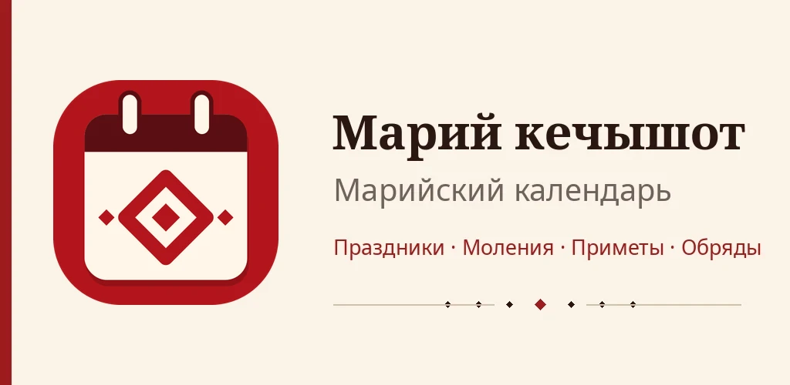
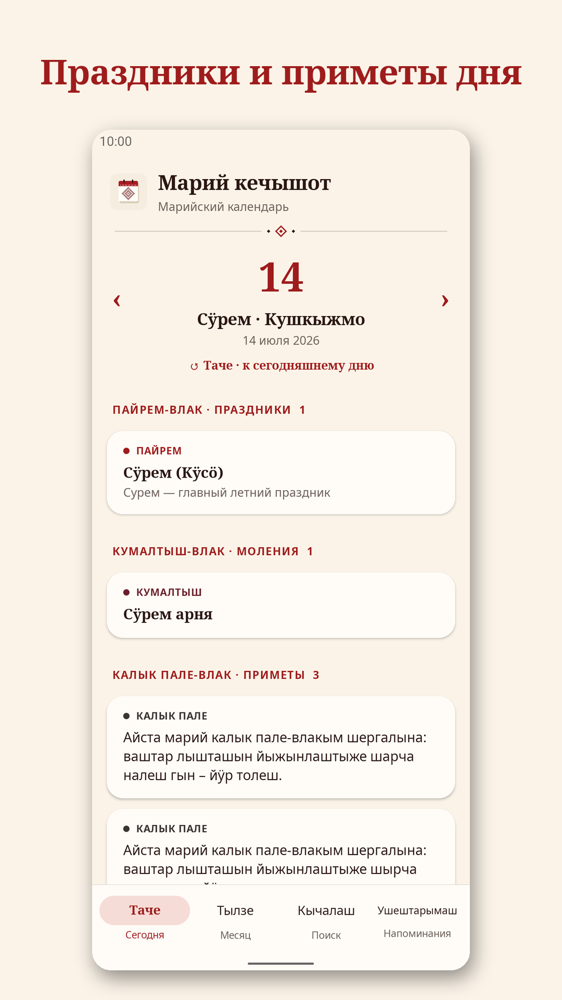
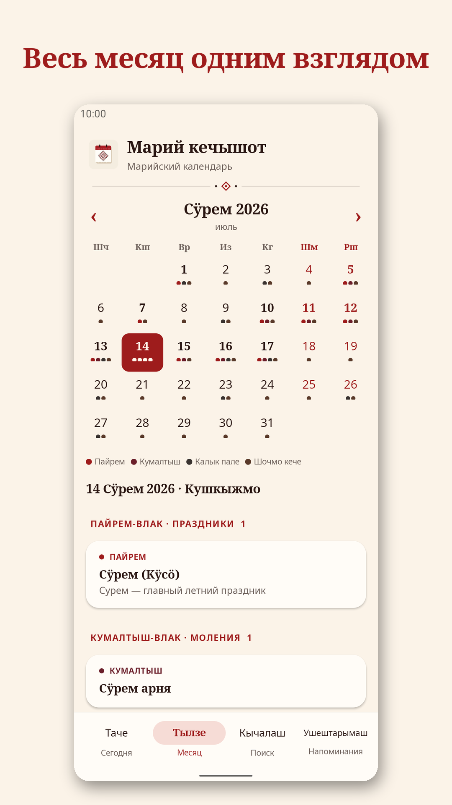
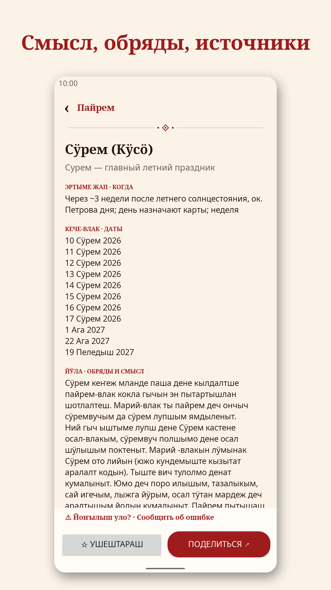
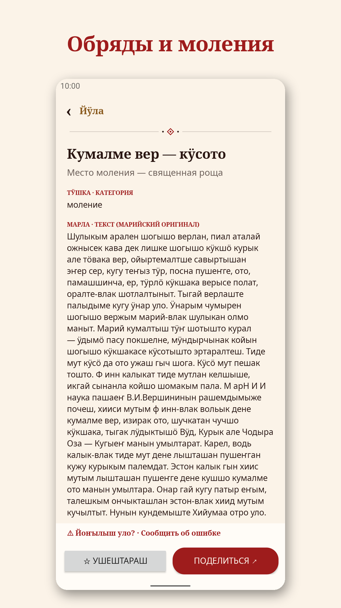
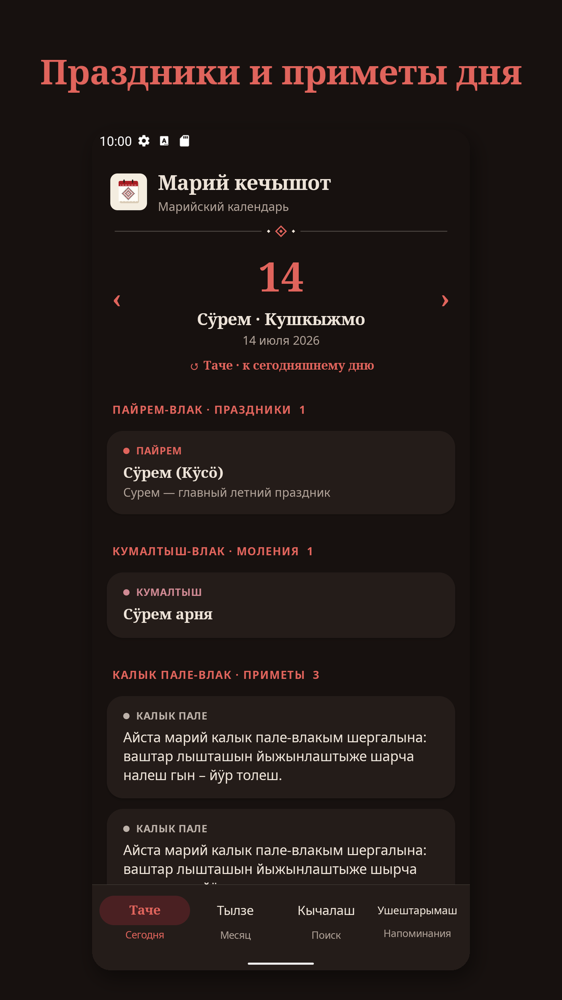
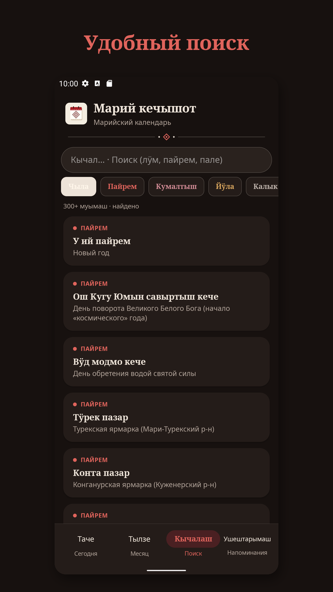
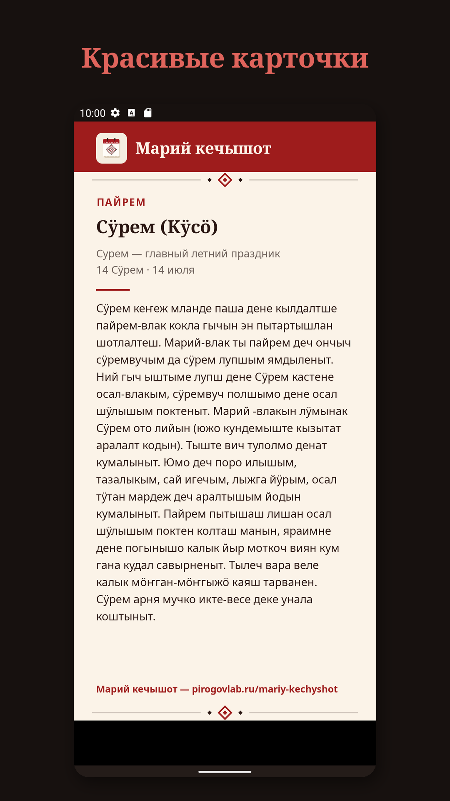

<p align="center"></p>

<h1 align="center">Марий кечышот — марийский календарь</h1>

<p align="center">
<a href="https://github.com/MihailPirogov/mariy-kechyshot/releases/latest"></a>


<a href="LICENSE"></a>
<a href="https://pirogovlab.ru/mariy-kechyshot/"></a>
</p>

<p align="center"></p>

**RU** · [EN](#english)

Календарь марийских праздников, молений, народных примет и обрядов на луговомарийском и русском языках. Работает без интернета и по утрам напоминает, что сегодня за день.

**Страница приложения:** https://pirogovlab.ru/mariy-kechyshot/ · **Скачать APK:** [Releases](https://github.com/MihailPirogov/mariy-kechyshot/releases/latest)

## Возможности
- **Таче (сегодня)** — праздники, моления, приметы и дни рождения известных марийцев на любой день; «примета дня».
- **Тылзе (месяц)** — календарь с цветными метками.
- **Пайрем** — праздники: смысл, обряды, даты на 2026–2027 и как они считаются.
- **Кумалтыш · Молитвы** — даты общих и деревенских молений и отдельный раздел с текстами молитв на марийском (строка над вкладками и меню ⋮).
- **Йӱла** — порядок марийского моления и семейных обрядов.
- **Пале (приметы)** — погодные, хозяйственные и бытовые.
- Поиск с фильтрами, напоминания (утренняя сводка и за 0–7 дней), карточки «поделиться», форма «Предложить праздник / сообщить об ошибке».
- Светлая и тёмная темы; марийские названия месяцев и дней недели.

## Скриншоты
<p>
   
</p>
<p>
   
</p>

## Данные
⚠️ **Полные календарные данные в репозиторий не входят** (права защищены). В `app/src/main/assets/events.json` лежат только три явно помеченных фиктивных примера, чтобы проект собирался. Формат — в [docs/DATA_SCHEMA.md](docs/DATA_SCHEMA.md).

Источники данных в приложении: Марий Эл Радио, Национальная библиотека им. С. Г. Чавайна, kelshymash.ru, «Меркаңаш», газета «Марий Эл», Кидшер, Республиканский центр марийской культуры, книги Н. С. Попова и А. И. Таныгина («Юмын йӱла»), В. М. Мамаева, Ю. А. Калиева.

## Сборка
Требуется JDK 17 и Android SDK 34.
```bash
./gradlew assembleDebug          # отладочная сборка
./gradlew assembleRelease        # без ключей получится неподписанный APK
```
Ключи подписи хранятся вне репозитория: `../mari-kechyshot-keys/keystore.properties` (или переменная `MARI_KEYS_DIR`) с полями `storeFile`, `storePassword`, `keyAlias`, `keyPassword`.

Структура: `app/` — приложение (Kotlin, View), `design/` — логотип и иконка (SVG), `store/` — скриншоты и тексты для магазинов, `tools/` — скрипты (скриншоты, монтажи, генерация иконки).

## Автор
Проект [PirogovLab](https://pirogovlab.ru) — Михаил Пирогов.

---

## English

**Mariy Kechyshot** is a calendar of traditional Mari holidays, community prayers, folk omens and rites, in Meadow Mari and Russian. Works offline and gives a morning “what's today” summary.

**App page:** https://pirogovlab.ru/en/mariy-kechyshot/ · **Download APK:** [Releases](https://github.com/MihailPirogov/mariy-kechyshot/releases/latest)

### Features
Today view with “omen of the day”, month view with colored dots, holidays with meaning and dates, prayer dates, rites, folk omens, search with filters, reminders, share cards, offline “suggest / report an error” form, light & dark themes.

### Data
⚠️ **The full calendar data is not included** (all rights reserved). `app/src/main/assets/events.json` contains three clearly fake sample entries so the project builds. Format: [docs/DATA_SCHEMA.md](docs/DATA_SCHEMA.md).
Sources used by the app: Mari El Radio, S. G. Chavain National Library, kelshymash.ru, Merkanash, “Mari El” newspaper, Kidsher, Republican Center of Mari Culture, books by N. S. Popov & A. I. Tanygin, V. M. Mamaev, Yu. A. Kaliev.

### Build
JDK 17 + Android SDK 34: `./gradlew assembleDebug`. Release signing keys are read from outside the repo (`../mari-kechyshot-keys/keystore.properties` or `MARI_KEYS_DIR`); without them `assembleRelease` produces an unsigned APK.

### License
Source code — [MIT](LICENSE). Calendar data, logo and store graphics — all rights reserved.

A [PirogovLab](https://pirogovlab.ru) project by Mikhail Pirogov.
